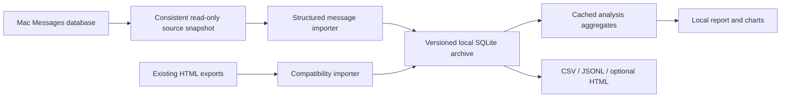

# Py-Message improvement plan

Status: implemented in the 0.2.0 local archive workflow. See README.md and PERFORMANCE.md for shipped behavior, measurements, and deliberate boundaries. Remote CI is configured; it has not been run from this workspace.

Delivery notes: changed conversations are reaggregated from cached per-message statistics, rather than updating each period by arithmetic deltas. Recovery atomically retries acquisition/reconciliation while reusing durable body-decoder checkpoints. Both Mac decoder binaries and their source/build manifest are included, so no external release publication or end-user Rust installation is required. The phases below retain the original proposal for traceability.

## Recommendation

Make a structured local message archive the foundation of the system. Generate
HTML, CSV, and charts from that archive. Keep the single-command launcher and the
managed upstream integration, while removing HTML parsing from the normal import
path after verifying feature parity.

Assumptions: local CLI application; no server or cloud account; metadata retained
by default; copying original media is optional; existing commands continue to work.

## Findings from the current code

1. Every database run exports the selected history again, parses the entire HTML
   document into a BeautifulSoup tree, writes CSV, rereads CSV for word counts,
   and rereads it again for timelines. Nothing is reused between runs.
2. The HTML importer repeatedly searches each message subtree. Nested replies
   increase the amount of repeated traversal. Word counting also builds a list
   of every token before counting it. Timeline analysis computes every time
   grouping even when the user asks for only one.
3. Analysis CSVs retain only Sender, Timestamp, ReadTime, and Content. Some richer
   information remains in the HTML, but stable identities, precise source times,
   thread structure, event history, and attachment metadata are not available as
   structured analysis data. Attachment files are not archived.
4. Times become local, timezone-free values with second precision. ReadTime is a
   rendered receipt duration, not an unambiguous source read timestamp or a
   conversational response time.
5. The ASCII-only tokenizer removes non-Latin scripts, alters accented words,
   and merges punctuation-separated words. TextingPatterns uses different word
   rules, contains hardcoded conversation paths and a contact number, executes
   examples on import, and is not part of the CLI pipeline.
6. One malformed message can fail a conversation. Output can be partially
   written, there is no resume/checkpoint model, and the summary omits stage
   timings, configuration, source schema, and exporter/parser versions.
7. Existing tests cover useful small examples, but most database tests use three
   empty placeholder tables with a mocked exporter. They do not establish
   compatibility across real Messages schemas or performance at archive scale.

## Measured baseline

A local synthetic sample of 5,000 simple messages, approximately 1.46 MB HTML,
with dependencies already imported:

| Stage | Elapsed time |
| --- | ---: |
| HTML parsing and CSV writing | 1.887 s |
| Word frequencies | 0.023 s |
| Weekly timeline | 0.100 s |
| Word cloud | 0.150 s |

Process peak RSS was approximately 173 MB, including Python and imported analysis
libraries. A separate 1,000-message profile attributed substantial time to repeated
CSS selection and DOM construction. The word-cloud measurement also included a
frequency-table reload. These are diagnostic measurements, not a full-system
benchmark: they exclude exporter work, setup/import startup, large media, and
deeply nested conversations. No personal messages were used.

## Phase 1 — Establish correctness and performance baselines

- Add reproducible synthetic datasets at 10k, 100k, and 1m messages, plus smaller
  rich-message fixtures with replies, edits, reactions, attachments, and Unicode.
- Measure startup, snapshot/export, parsing/decoding, storage, aggregation,
  rendering, peak memory, and disk footprint separately. Include both one huge
  conversation and many small conversations.
- Benchmark first import, unchanged rerun, append-only updates, and updates to
  old messages. Keep machine/runtime details with results.
- Add source-versus-import reconciliation counts and explicit categories for
  messages, reactions, announcements, duplicates, unsupported parts, and failures.
- Make TextingPatterns safe to import and move personal examples out of library
  modules. Define one shared analysis configuration and consistent metric names.

Completion: reproducible benchmarks and fixtures, clear metric definitions, and
all modules import without reading conversation files or printing message data.

## Phase 2 — Preserve source data and introduce the archive

- Create a consistent snapshot using SQLite's backup API from a read-only source
  connection, accounting for WAL-backed databases. Do not copy only the live
  chat.db file. Publish a snapshot only when backup completes successfully.
- Add a versioned SQLite archive with migrations and tables for sources, physical
  chats, participants, message/chat membership, messages, message parts, reactions,
  edits, receipt events, attachments, import errors, and runs.
- Preserve GUIDs and original chat/handle identifiers. Keep display names and
  optional contact-based conversation grouping separate from identity.
- Retain original timestamp integers and their units, UTC values, and the report
  timezone. Store sent, delivered, read, edited, and retracted times separately.
- Preserve original text, decoded parts, raw payload/blob data where available,
  service/direction/status fields, observed revisions, source schema, and decoder
  provenance. Unknown values remain unknown; decode failures retain raw data.
- Keep the latest successful source snapshot for reprocessing. Make retaining
  historical snapshots configurable to avoid unnecessary full-database copies.
- Store attachment metadata and availability by default. Offer an archive-media
  option that copies available originals with hashes and deduplication; report
  missing or iCloud-only assets explicitly. Database snapshots do not contain media.

Completion: retained information can be reanalyzed without the live source; stable
IDs survive contact renames; UTC/DST and receipt semantics are tested. Preservation
covers data actually observed and available, not history already removed upstream.

## Phase 3 — Replace the HTML intermediate with structured ingestion

- Prototype a small Rust companion wrapping the pinned imessage-database library,
  emitting a versioned JSONL record stream to Python. Its documented API already
  exposes schema-aware message iteration, body components, and edit history.
- This is a new adapter: the current imessage-exporter CLI exposes HTML/TXT, so
  do not assume an existing JSON export switch.
- Decode through the upstream library rather than relying only on message.text
  or implementing Apple's archived body formats from scratch.
- Batch-import records into archive transactions with indexes for GUIDs, chat
  membership, timestamps, and participants. Bound memory by batch size.
- Verify IDs, text, thread relationships, events, and counts against source
  fixtures and the current exporter before changing the default path.
- Distribute verified prebuilt companion binaries for Apple Silicon and Intel,
  with upstream attribution/source and license information. End users should
  continue to need neither Cargo nor a separate exporter installation.
- Keep existing HTML import as a compatibility adapter, with provenance marking
  fields that cannot be reconstructed. Keep upstream HTML export optional.

Decision gate: prove decoder parity and a maintainable prebuilt-release process
before making the companion the default. Until then, the managed HTML path remains
functional and imports into the same archive; source preservation does not wait.

Reference: [imessage-database API example](https://github.com/ReagentX/imessage-exporter/blob/5.0.1/imessage-database/README.md)

## Phase 4 — Make repeat runs incremental and resumable

- Upsert using source identity plus stable record IDs and content fingerprints.
  Import new records and reconcile changed older records, including receipts,
  reactions, edits, contact mappings, and chat membership.
- Do not use only the last message date/ROWID or the main database file's mtime:
  old rows can change, and WAL contains committed data.
- Start with a correctness-first source reconciliation scan, then decode only
  changed records. A source scan may still be linear; unchanged decoding and
  rendering should disappear. Optimize change detection only with a verified
  change mechanism or an explicit reconciliation policy.
- Preserve observed history when records disappear; distinguish absence from an
  explicit deletion event. Only infer absence from a complete comparable scan,
  never from a filtered or interrupted import.
- Apply conversation/date filters to archive queries by default. Track any scoped
  imports explicitly so incomplete coverage is visible.
- Invalidate aggregates for affected conversations and periods. Fingerprint report
  inputs, analysis settings, dictionary contents, timezone, and tool versions.
- Add transactions, checkpoints, run states, a concurrent-run lock, atomic output
  writes, resume, and an explicit full-rebuild command.

Completion: unchanged reruns do no decoding or report rendering; interrupted runs
resume safely; an incremental result equals a clean rebuild after both additions
and mutations to old records.

## Phase 5 — Speed up and improve the analysis

- Read archive records in batches or query indexed aggregates instead of passing
  data through temporary CSVs. Compute related statistics together and only for
  the requested timeframes. Reuse parsed dates and token statistics.
- Update Counters incrementally, cache dictionaries, and remove the all-token
  list. Separate preserved original text from normalized analysis tokens.
- Use Unicode-aware text handling with explicit rules for apostrophes, accents,
  hyphens, emoji, URLs, and languages requiring segmentation. Version those rules
  so cached counts are reproducible.
- Integrate corrected texting-pattern statistics: message/word/character counts,
  activity over time, participant shares, attachment/reaction counts, and edited
  message counts. Define denominators and use weighted totals where appropriate.
- Add conversation-turn response statistics with documented gap and group-chat
  rules; keep them separate from delivery/read receipt delays.
- Make rendering selective: report-only, selected conversations, top-N word-cloud
  vocabulary, and skipped unchanged charts. Avoid thousands of unnecessary PNGs.
- After profiling, add a bounded process pool for independent CPU-heavy work.
  Keep Matplotlib isolated per process and serialize database writes. Cap workers
  and in-flight tasks so parallelism does not multiply peak memory uncontrollably.

Completion: benchmarked time/memory improvement with unchanged analysis results
where definitions are unchanged; accurate multilingual/emoji handling; no
unbounded token accumulation. Set numeric speed targets after Phase 1 establishes
representative first-run and repeat-run baselines.

## Phase 6 — Deliver a coherent application

- Organize the library into CLI, sources, decoding, storage, analysis, reports,
  and export modules. Add pyproject packaging, tested dependency locks, and a
  normal Python entry point while preserving the launcher and old helper wrappers.
- Offer sync, analyze, report, export, and doctor commands. The default launcher
  still performs the complete workflow in one command.
- Generate a local report index linking conversations, charts, statistics,
  provenance, and coverage warnings. An interactive browser UI is optional later.
- Report progress by stage with added/changed/skipped/unsupported/error counts,
  timing, and clear recovery guidance. Persist machine-readable run manifests.
- Quarantine malformed records without losing their original payloads; make
  partial results visibly partial. Offer strict mode for validation.
- Test multiple Messages schemas, null/invalid timestamps, nested and orphaned
  replies, sender renames, duplicate handles, rich-message events, missing media,
  locked/WAL databases, cancellation, resume, concurrent runs, and cache upgrades.
- Add macOS CI smoke tests with the actual pinned native tools, unit tests on
  other supported platforms, and non-flaky performance regression checks.

Completion: one command works from a clean checkout, archived data can be used
offline, legacy commands remain usable, and reports explain data coverage and
failures without requiring the user to inspect logs.

## Delivery order and validation gates

Implement Phases 1–2 first; build the structured-adapter proof in Phase 3; then
incremental synchronization, analysis improvements, and packaging/report polish.
Small reductions in repeated CSV reads and token allocations can land early,
but avoid investing heavily in an HTML parser that will leave the default path.

Release gates:

1. Source message/event counts reconcile or have explicit documented exclusions.
2. Raw retained data remains accessible when decoding fails.
3. Incremental imports and clean rebuilds agree for old and new record changes.
4. Original source data is never modified; interrupted work cannot publish a
   successful-looking incomplete archive/report.
5. Performance is measured on the same fixtures and machine, with both ingestion
   and report rendering reported separately.
6. No-op runs avoid expensive repeat work, and large imports use bounded batches.
7. Managed native dependencies remain automatic for end users.
